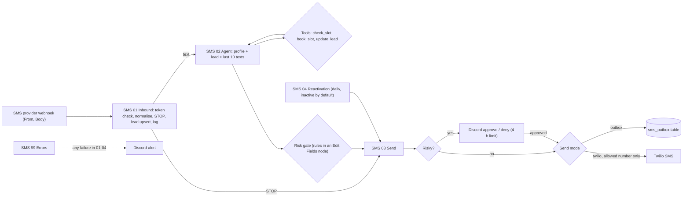

# Case Study: AI SMS Lead Agent for Service Businesses

**An n8n agent that answers a service business's inbound texts in seconds, qualifies the lead, books a quote visit on a real calendar, and holds every risky reply for a person to approve in Discord.**

    

| | |
|---|---|
| **Type** | Portfolio build (reference implementation, not a client engagement) |
| **My role** | Sole designer and builder: agent prompt and output contract, risk rules, calendar booking tools, opt-out handling, approval flow, test set and scoring |
| **Scale** | 5 workflows, 71 nodes, 5 data tables, 4 external services (LLM API, Google Calendar, Discord, Twilio) |
| **Stack** | n8n (AI Agent, data tables, Execute Workflow, Error Trigger), NVIDIA Build API (OpenAI-compatible), Google Calendar, Discord bot, Twilio (optional) |
| **Status** | Tested on 30 labelled synthetic conversations, twice (results below). Not run on real customer traffic or a real business number. |
| **Results** | 10 of 10 risky replies held for approval, 3 of 3 opt-outs honoured, 26 of 27 intents correct (synthetic set, run 2) |

---

## The problem

A small trade business gets most enquiries by text. The owner is on a roof or under a house and replies hours later, by which time the customer has booked someone else. A plain auto-reply ("thanks, we'll get back to you") does not win the job. A fully automatic AI reply wins speed but can quote a wrong price, promise a time that is taken, or answer a complaint in a way the owner would never sign off.

## Outcome

- Every inbound text gets a reply in the business's own voice, usually within a few seconds.
- The agent asks one question at a time (job, suburb, urgency, name), checks the calendar and books a quote visit only after the customer agrees a time.
- Price questions, complaints, refunds, cancellations, reschedules, safety topics and low-confidence answers wait for a person to approve or deny in Discord before anything is sent.
- STOP, UNSUBSCRIBE and similar words are handled before the AI sees the text: one confirmation, then silence.
- Replies go to an outbox table by default. Real texts go through Twilio only when switched on, and only to one allowed number.
- On the final synthetic run: 10 of 10 risky replies held for approval, 16 of 17 safe replies sent without approval, 3 of 3 opt-outs honoured, 0 of 27 fallbacks.

---

## Architecture



### Stage by stage

| # | Stage | What it does | Why it is built this way |
|---|---|---|---|
| 1 | SMS 01 Inbound (16 nodes) | Webhook with header-token auth answers the provider at once (`<Response></Response>`), cleans the number and text, drops junk, catches STOP words, finds or creates the lead, logs the text, hands it to the agent without waiting. | Accepts the Twilio field shape (`From`, `Body`), so any provider or a test form can plug in. STOP is decided by a fixed list, never by the model. |
| 2 | SMS 02 Agent (21 nodes) | Loads the business profile, the lead and the last 10 messages (denied replies left out), runs a tool-calling agent, parses a fixed JSON reply, applies the risk rules, updates the lead status, hands the reply and the customer's text to SMS 03. | History comes from the messages table, so it survives restarts and is visible. A reply a person denied was never sent, so the agent never sees it as said. The gate is outside the agent so a reviewer can read the rules. |
| 3 | SMS 03 Send (19 nodes) | Blocks opted-out numbers, sends risky replies to Discord (customer's text, draft reply, intent and reason) and waits, then writes to the outbox or sends through Twilio, logs the result and touches the lead. | All sends go through one workflow, so suppression and approval cannot be skipped by any caller. The approver sees what was asked next to what would be sent. |
| 4 | SMS 04 Reactivation (12 nodes) | Daily at 10:00 (Brisbane time): picks leads quiet for 30 days that are not booked, handed off or opted out, caps the batch, writes a short check-in that always ends with an opt-out line, and sends each through SMS 03 with approval on. | Exported inactive. Nudges are capped at 2 per lead and spaced at least 7 days apart. |
| 5 | SMS 99 Errors (3 nodes) | Error Trigger posts the workflow name, failing node, error and execution link to Discord. | Set as the Error workflow on SMS 01-04, so nothing fails silently. |

---

## Deep dives

### The agent's output contract

The agent must return this JSON (Structured Output Parser, with Auto-Fix Format and its own temperature-0 model):

```json
{
  "reply": "string",
  "intent": "enquiry | qualify | book | reschedule | cancel | price | complaint | handoff | off_topic | other",
  "risk": true,
  "risk_reason": "string",
  "confidence": 0.9,
  "booked_start": "ISO time or null"
}
```

The system message is built from the business profile row (services, area, hours, booking rules, price policy, handoff rules, tone) plus fixed rules: at most 2 sentences and 300 characters, one question at a time, only offer times `check_slot` says are free, call `book_slot` only after the customer agrees, never invent prices, policies or availability.

### The risk gate, in plain rules

```text
risky = model says risk
     OR confidence < confidence_floor (0.7)
     OR intent in [price, complaint, cancel, reschedule, handoff]
     OR reply longer than 300 characters
```

The model's own `risk` flag is one input, not the only one. A price question tagged with the wrong intent is still held if the model flags it, and a correct intent is held even if the model forgets the flag.

### One profile row per business

Everything business-specific lives in `sms_business_profile` and `sms_settings`. The repo seeds two profiles (an aircon installer and a dental clinic); a lead's `profile_key` decides which voice and rules the agent uses.

### Provider-agnostic sending

Only SMS 01 (receive) and SMS 03 (send) touch the SMS provider. `send_mode = outbox` writes replies to a table at no cost. `send_mode = twilio` sends through Twilio, but only when the recipient equals `twilio_allowed_to`; anything else is logged as `blocked_not_verified`.

---

## Decision log

### Decision 1: Webhook in the Twilio shape, not the Twilio trigger node
- **Options:** Twilio trigger node; generic webhook.
- **Chose:** generic webhook with `From` and `Body`.
- **Cost or safeguard:** no paid number needed to test; swapping provider touches two workflows. Header token instead of signature validation (see Configuration).

### Decision 2: Risk rules outside the agent
- **Options:** trust the model's `risk` flag; rules in a node.
- **Chose:** an Edit Fields node with readable rules plus the model's flag.
- **Cost or safeguard:** more replies wait for a person (a reschedule offer is held even when it is correct). The owner approves with one click.

### Decision 3: Discord send-and-wait for approval
- **Options:** Slack, email, Discord.
- **Chose:** Discord buttons with a 4-hour wait limit. Each message shows the last 3 digits of the number, the intent and reason, the customer's text and the draft reply:
  ```text
  reply to ...022 | intent price | why: Customer asked for a price quote
  Customer: How much for a split system service?
  Draft reply: We don't quote over the phone. Our technician quotes on site after seeing the job. What's your suburb?
  ```
- **Cost or safeguard:** the customer waits for the owner on risky topics, which is the point.

### Decision 4: Conversation history from a table
- **Options:** n8n memory sub-node; last 10 rows of `sms_messages`.
- **Chose:** the table.
- **Cost or safeguard:** history survives restarts and doubles as the audit log.

### Decision 5: Auto-fix the reply format
- **Options:** retry the agent; fall back on any format error; auto-fix.
- **Chose:** the parser's Auto-Fix Format with a temperature-0 model, and the fallback reply if that also fails.
- **Cost or safeguard:** one extra LLM call only when the first answer is not valid JSON.

### Decision 6: STOP handled before the AI
- **Options:** let the agent detect opt-outs; fixed word list.
- **Chose:** STOP, STOP ALL, UNSUBSCRIBE, END, QUIT, matched exactly. "Cancel" is not on the list because here it usually means a booking.
- **Cost or safeguard:** a creative opt-out ("please never text me") goes to the agent and is held as a handoff rather than missed silently.

---

## Failure modes I designed for

| What goes wrong | What happens |
|---|---|
| Request without the header token | n8n answers 403; no execution runs. |
| Sender missing or not a phone number | `Valid?` sends it to `Ignored`; no rows written. |
| Model returns prose instead of JSON | Auto-Fix Format reformats it; if that fails, the fallback reply ("someone will text you back shortly") is held for approval. |
| LLM API down or model removed | Same fallback path; the customer is never left unanswered. |
| Customer asks for a time that is taken | `check_slot` says busy; the agent offers another free time; no event is created. |
| Customer texts after opting out | Logged with approval `blocked`; no reply. |
| Twilio rejects a send | Row logged as `failed`; no retry (a retry can duplicate a text). |
| Twilio mode on, recipient not allowed | Logged as `blocked_not_verified`; nothing sent. |
| Any unhandled error in SMS 01-04 | SMS 99 posts the workflow, node, error and execution link to Discord. |
| Owner denies a draft reply | Logged as `denied` in `sms_outbox` and `sms_messages`; nothing is sent, and the agent's history leaves it out, so the next reply does not assume it was said. |
| Nobody approves within 4 hours | The wait ends and the reply is not sent. |

## Data model

| Table | Purpose / fields used |
|---|---|
| `sms_settings` | One row: `active_profile`, `send_mode`, `discord_channel_id`, `calendar_id`, `timezone`, `slot_minutes`, `twilio_from`, `twilio_allowed_to`, `reactivation_days`, `reactivation_max_per_run`, `reactivation_needs_approval`, `confidence_floor`. |
| `sms_business_profile` | One row per business: `profile_key`, `business_name`, `services`, `service_area`, `hours`, `booking_rules`, `price_policy`, `handoff_rules`, `tone`. |
| `sms_leads` | `phone` (E.164), `name`, `profile_key`, `status` (new, qualifying, booked, handoff, cold, opted_out), `job_type`, `suburb`, `urgency`, `booked_at`, `last_inbound_at`, `last_outbound_at`, `reactivation_count`, `test_label`. |
| `sms_messages` | Every text in and out: `phone`, `direction`, `body`, `kind`, `intent`, `approval`, `created_at`, `test_label`. |
| `sms_outbox` | Every send attempt: `phone`, `body`, `kind`, `mode`, `status` (simulated, sent_twilio, denied, blocked_not_verified, failed), `provider_sid`, `created_at`, `test_label`. |

## Testing and verification

**How it was tested.** 30 synthetic texts, labelled before sending with the accepted intents and whether a person must approve the reply: 8 booking (4 two-turn threads, one asking for a slot another customer had just booked), 5 qualifying, 4 price, 3 complaint, 2 cancel or reschedule, 3 STOP and after-STOP, 3 off-topic, 2 for the dental profile. Senders were fictional numbers from the Australian regulator's reserved list. Each text went through the published production path (webhook → agent → send) in outbox mode, with real calendar reads and writes on a test calendar. Model: `nvidia/nemotron-3.5-super-vl-120b-a12b` on the NVIDIA Build free tier. Each run was a single pass; the set, raw results and scoring script are in `test/`.

**Run 1** (set `testset.json`):

| Measure | Result |
|---|---|
| Intent correct | 21 of 27 |
| Risky replies held for approval | 10 of 10 |
| Safe replies sent without approval | 12 of 17 |
| Opt-out rule held | 3 of 3 |
| Bookings created | 3 of 3 |
| Fallback replies | 5 of 27 |
| Reply time | median 5.0 s, max 19.7 s |

**Run 2** (same texts and labels, fresh numbers, booking dates one week later; set `testset_run2.json`):

| Measure | Result |
|---|---|
| Intent correct | 26 of 27 |
| Risky replies held for approval | 10 of 10 |
| Safe replies sent without approval | 16 of 17 |
| Opt-out rule held | 3 of 3 |
| Bookings created | 3 of 3 |
| Price replies without a figure | 4 of 4 |
| Fallback replies | 0 of 27 |
| Reply time | median 4.9 s, max 15.8 s |

Paths also checked end to end: missing and wrong token (403, no execution), a non-text sender (ignored), Discord Approve (reply written to the outbox) and Deny (logged as denied, nothing sent), the agent-error fallback, an unhandled error reaching the Discord alert, a Twilio rejection logged as `failed`, and a Twilio send to a number not on the allow list logged as `blocked_not_verified`.

### What did not go perfectly
- **Format failures in run 1.** 5 of 27 agent answers were prose instead of JSON, so they fell back to the holding reply and waited for a person. The parser's Auto-Fix Format was switched on between runs; in run 2 it was needed twice and both were repaired.
- **Correct reply, strict tag.** In run 2 the agent handled the taken slot well ("10am is taken. How about 9am that same day?") but tagged it `reschedule`, so the rule held it for approval. Safe, but one extra click for the owner.
- **Approval check after the runs.** The live Approve and Deny check showed two gaps, both closed after the measured runs: the Discord message showed only the draft, not what the customer asked, and a denied draft stayed in the agent's history as if it had been sent. A follow-up text from the denied customer then confirmed the history held only their own messages.
- **Booking offers are not holds.** Two first-turn replies offered the same free slot to different customers; only the first to accept gets it, and the second is offered another time by `check_slot`.
- **Scope.** Synthetic texts, one pass per run, one person writing the labels: a regression baseline, not production accuracy.

## Configuration and swap-ins
Everything below is a setting or a node swap, not a rewrite. The defaults are what I used because they are free or cheapest, not because the design needs them.

| What | Default here | Change it to |
|---|---|---|
| LLM | NVIDIA Build, `nvidia/nemotron-3.5-super-vl-120b-a12b`, via the OpenAI Chat Model node | Any OpenAI-compatible model with tool calling (Chat model and Fix model nodes in SMS 02, Chat model in SMS 04) |
| SMS provider in | Webhook expecting `From`, `Body` | Twilio, GoHighLevel or any provider that can post those fields |
| SMS provider out | `send_mode = outbox` | `twilio` with `twilio_from` and `twilio_allowed_to`, or another provider node in SMS 03 |
| Webhook security | Header Auth credential, header `x-sms-agent` | Twilio request signature validation (`X-Twilio-Signature`) before going live |
| Approval channel | Discord bot, send-and-wait, 4 h | Slack or email send-and-wait nodes |
| Calendar | Google Calendar (`calendar_id` in settings), 60-minute slots | Another calendar tool node |
| Business | `sms_business_profile` row | A new row and a lead `profile_key` |
| Confidence floor | 0.7 | Any value in `sms_settings` |
| Reactivation | Inactive; 30 quiet days, 5 per run, approval on | Publish SMS 04 and tune the settings row |
| Re-subscribe | Not included: an opted-out number stays out | Add a START branch in SMS 01 |

## Skills used
- **AI agents in n8n:** tool calling (calendar availability, event create, data table update), structured output with auto-fix, prompt built from data.
- **Human-in-the-loop design:** rule-based risk gate, Discord send-and-wait approvals with a time limit.
- **Messaging compliance:** opt-out handled before the model, one confirmation, suppression enforced at the single send point, opt-out line on every check-in.
- **Workflow architecture:** sub-workflows with typed inputs, provider-agnostic edges, error workflow alerts, data tables as state and audit log.
- **Testing:** labelled synthetic set, scripted scoring, failure-path checks, a measured re-run after a change.

## Repository

| File | Purpose |
|---|---|
| `workflows/01-sms-inbound.json` | Webhook, STOP handling, lead upsert, hand-off to the agent |
| `workflows/02-sms-agent.json` | Agent, tools, output parser, risk gate |
| `workflows/03-sms-send.json` | Suppression, approval, outbox or Twilio send, logging |
| `workflows/04-sms-reactivation.json` | Daily check-ins for quiet leads (inactive) |
| `workflows/99-sms-errors.json` | Discord alert for failures |
| `samples/inbound-sms.json` | Example webhook body |
| `samples/agent-output.json` | Example parsed agent output |
| `samples/business-profile.json` | Example profile row |
| `test/testset.json`, `test/testset_run2.json` | The labelled texts for each run |
| `test/results_raw.json`, `test/results_run2_raw.json` | Per-item agent output from each run |
| `test/score.py` | Scoring script; `score_run1.json` and `score_run2.json` are its output |

### Run it yourself
1. Import the workflows into n8n. All are exported **inactive**.
2. Replace every placeholder (`REPLACE_ME`, `YOUR_*`, `WORKFLOW_ID_*`), re-select credentials, re-link the Execute Workflow nodes and set the Error workflow on SMS 01-04 to SMS 99.
3. Create the five data tables with the fields above, add one `sms_settings` row (`send_mode` = `outbox`) and one profile row (see `samples/business-profile.json`). Credentials: Header Auth (header `x-sms-agent`), an OpenAI-compatible LLM key, Google Calendar OAuth2, a Discord bot, and Twilio only if you will send real texts.
4. Publish SMS 99, SMS 03, SMS 02 and SMS 01 in that order, then post a test text:
   ```bash
   curl -X POST "https://YOUR_N8N_HOST/webhook/sms-inbound" \
     -H "x-sms-agent: YOUR_TOKEN" -H "Content-Type: application/json" \
     -d @samples/inbound-sms.json
   ```
   The reply appears in `sms_outbox` (or in Discord, waiting for approval).

### Responsible use
Texting customers is regulated. In Australia the Spam Act 2003 requires consent, clear sender identification and a working unsubscribe; the US (TCPA), UK (PECR) and EU (GDPR) have their own rules. This build answers people who texted first, honours STOP before any AI step, and adds an opt-out line to every check-in, but the business remains responsible for consent and for what it approves. Use the Twilio switch only with numbers you are allowed to text.

Brand names, people and phone numbers are fictional demo data. MIT licensed.
